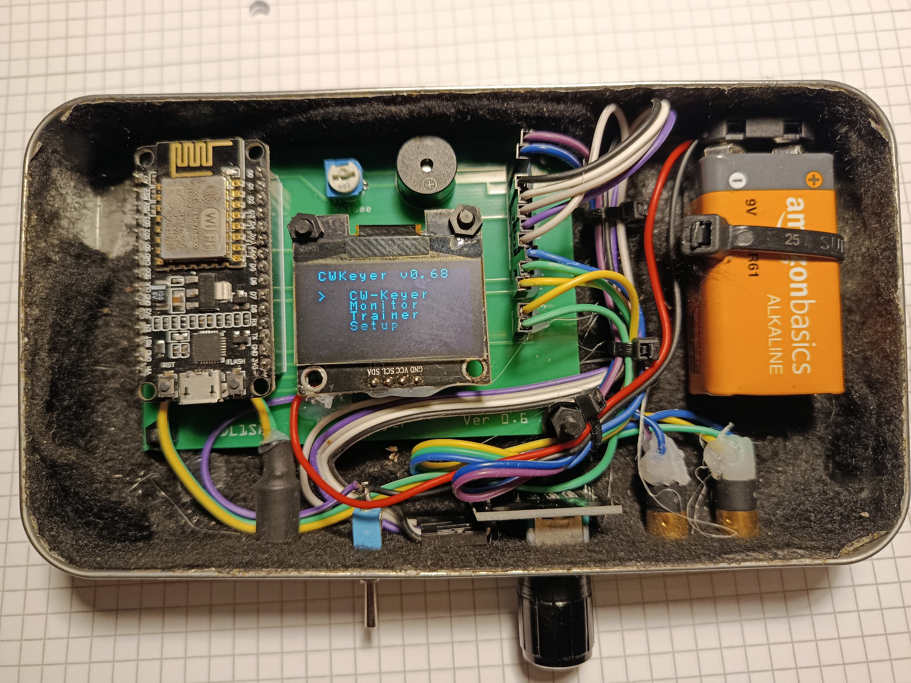
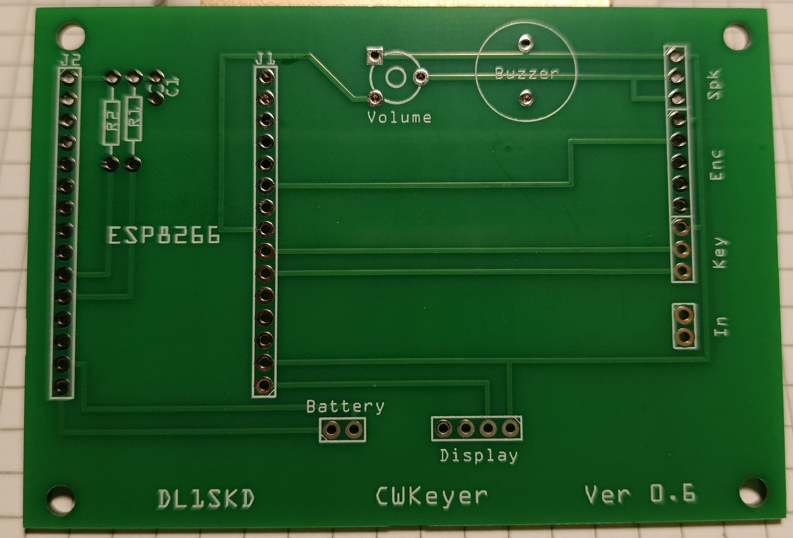
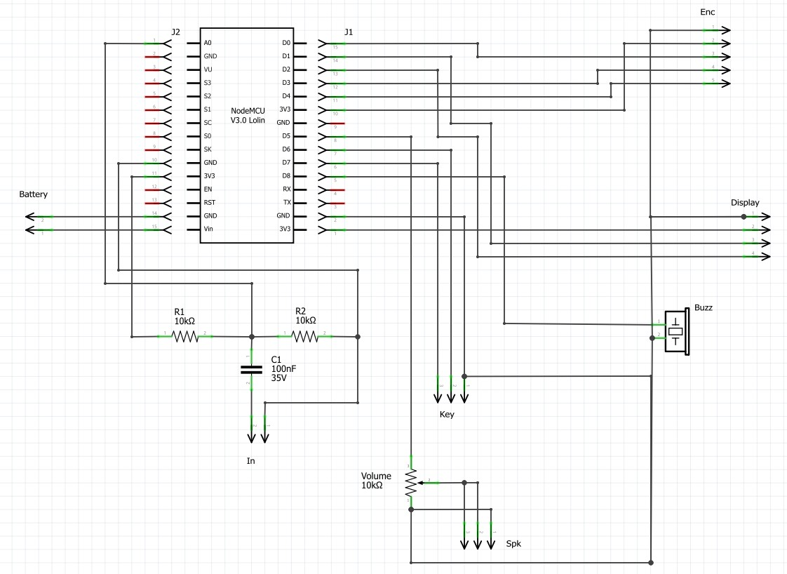

# CWKeyer

A simple CWKeyer for CW-Paddles based on a ESP8266 with WebInterface.  

SSID:     CWKeyer  
PW:       123456789  
Address:  192.168.4.2  

# Features

- Adjustable speed in WPM and Farnsworth
- Internal buzzer for sound output ( can be deactivated in software )
- Optional transceiver TX keying output (Setup menu; GPIO3/RX, active high)
- LineOut
- 2 Memories for 128 char's each
- WebInterface for setting the memory and training data
- CW Audio decoder ( Under 'Docs' you can find a 'How it works' )

# Images

# PCB

# Circuit

The TX keying output is disabled by default and can be enabled in the Setup menu.
It is active during paddle keying and memory playback, but not during trainer
playback. GPIO3 is also the ESP8266 UART RX pin, so do not use serial input while
the TX output is enabled. Connect the output to the transceiver through a
transistor or optocoupler; do not connect the ESP8266 GPIO directly to a
transceiver key input.

