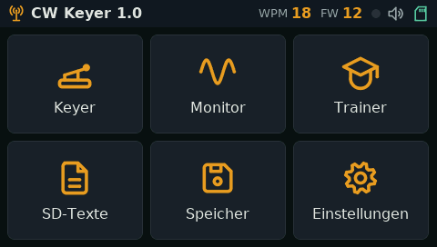
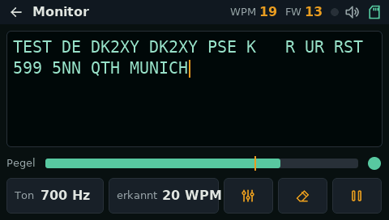
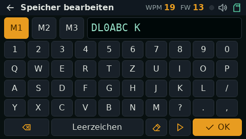
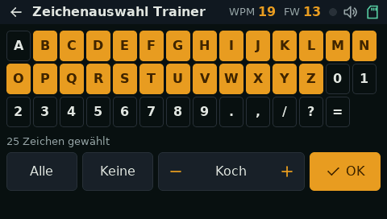

# CW Keyer – STM32F746G-DISCO

Portierung des ESP8266-CW-Keyers (`../CWKeyer_org`) auf das STM32F746G-Discovery-Board
mit Touch-Bedienung, Audio über den WM8994-Codec und Übungstexten von SD-Karte.

| Start | Keyer | Monitor |
|---|---|---|
|  |  |  |
| **Trainer** | **Übung** | **SD-Texte** |
|  |  |  |
| **Speicher** | **Einstellungen** | **Zeichenauswahl** |
|  |  |  |

(Screenshots aus dem PC-Simulator, gleicher Code wie auf dem Board.)

## Funktionen

| ESP8266 (Original) | STM32F746G-DISCO |
|---|---|
| OLED-Textmenü + Drehgeber + Mode-Taste | Touch-Display 480×272, Kacheln mit Icons |
| Iambic-Keyer an D6/D7 | Paddles an Arduino-Leiste D2 (Dit) / D3 (Dah), zusätzlich Handtaste D4, TX-Ausgang D5 |
| Buzzer / `tone()` 1000 Hz | Mithörton über Kopfhörerausgang (grün), 400–1000 Hz, Lautstärke, weiche Flanken (kein Klicken) |
| Decoder über A0 (Goertzel, 8,9 kHz) | Decoder über Line-In (blau) des Codecs, 16 kHz, Goertzel + adaptive Schwelle, WPM-Anzeige, Pegelanzeige |
| 2 Speicher (Web-Seite) | 3 Speicher M1–M3, Bearbeitung mit Bildschirmtastatur |
| Trainer-Buchstaben (Web-Seite) | Zeichenauswahl A–Z, 0–9, `. , / ? =` + Koch-Lektionen |
| Farnsworth über Encoder | alle Einstellungen in „Einstellungen“ (Tempo, Audio, Keyer, Decoder, Texte, Info) |
| EEPROM | interner Flash, Sektor 7, mit Wear-Levelling |
| – | Übungstexte `*.txt` von SD-Karte, Wiedergabe mit Mitlauf-Markierung oder verborgen (Mitschreiben) |

Trainer-Modi wie im Original: *Hören* (5er-Gruppen, weiter mit E/T), *Geben zufällig*, *Geben A–Z*,
*Hören + Geben* – jetzt mit Trefferquote und ohne blockierendes `delay(1000)`.

## Architektur

```
            ┌──────────────────────────── Gui/ ─────────────────────────────┐
            │ screens/scr_*.c   ui.c (Widgets)   gfx.c (Renderer)           │
            │ fonts.c / icons.c (generiert)                                 │
            └───────────────┬───────────────────────────────────────────────┘
                            │ liest Zustand, ruft App-Funktionen
            ┌───────────────▼──────────── App/ (hardwareunabhängig) ────────┐
            │ app.c  ── verbindet alles, Event-Queues, Mithörton-Synthese   │
            │ keyer.c   player.c   cw_decoder.c   trainer.c                 │
            │ morse.c   morse_timing.c   settings.c   text_source.c         │
            └───────────────┬───────────────────────────────────────────────┘
                            │ port.h (Hardware-Abstraktion)
     ┌──────────────────────▼──────── Platform/ ──────────────┐  ┌── Lib/ ──────┐
     │ port_stm32.c  audio_codec.c (SAI2+WM8994)  display.c   │  │ fat_ro.c     │
     │ touch.c  flash_store.c  board.c (GPIO, 1-ms-Tick)      │  │ FAT16/32 RO  │
     └──────────────────────┬─────────────────────────────────┘  └──────────────┘
                            │
     Core/ (main, Takt, MPU/Cache, Interrupts)   Drivers/ (ST HAL, CMSIS, BSP)
```

**Ausführungskontexte**

| Kontext | Takt | Aufgabe |
|---|---|---|
| SysTick-Interrupt | 1 kHz | `app_tick_1ms()`: Paddles entprellen, Keyer, Text-Wiedergabe, TX-Ausgang |
| SAI-DMA-Interrupt | alle 4 ms | `app_audio_block()`: Decoder (Goertzel), Mithörton, Durchschleifen Line-In |
| Hauptschleife | ~30 fps | `app_poll()` (Events, Trainer, Einstellungen speichern), GUI zeichnen, Touch |

Interrupts → Hauptschleife über lock-freie Event-Queues (`event_queue.h`).
Alles in `App/`, `Gui/` und `Lib/` ist ohne STM32 übersetzbar – daher gibt es Unit-Tests und
einen PC-Simulator (siehe unten).

**Zuordnung Original → neu**

| ESP-Datei | neu |
|---|---|
| `MainLoop.ino` (Paddle-Logik) | `App/Src/keyer.c` |
| `SetupPlayback.ino` (`startPlayback/updatePlayback`) | `App/Src/player.c` |
| `StorageNavigation.ino` (`CalculateTimes`) | `App/Src/morse_timing.c` |
| `MorseAudio.ino`, `MorseCode.h` | `App/Src/morse.c`, Mithörton in `app.c` |
| `Decoder.ino` | `App/Src/cw_decoder.c` |
| `Screens.ino` (Trainer-Teile) | `App/Src/trainer.c` |
| `Screens.ino`, `InputMenus.ino`, Encoder | `Gui/Src/screens/*.c` |
| `WebServer.ino`, `WebPage.h` | `scr_memory.c`, `scr_letters.c`, `scr_settings.c` |
| EEPROM | `App/Src/settings.c` + `Platform/Src/flash_store.c` |

**Verbesserungen gegenüber dem Original-Decoder:** Die Schwelle folgte im Original auch dem Rauschen
in Pausen (Fehltrigger bei verrauschtem Empfänger). Jetzt getrennte Spitzen- und Rauschboden-Verfolgung
mit SNR-Bedingung, getrennte Mittelwerte für Dit und Dah (schnellere Anpassung an Tempowechsel) und
Wortlücken-Erkennung, die auch mit Farnsworth-Abständen funktioniert.

## Anschluss

| Signal | Arduino-Leiste | MCU-Pin |
|---|---|---|
| Paddle Dit | D2 | PG6 (Pull-up, gegen GND schalten) |
| Paddle Dah | D3 | PB4 (Pull-up, gegen GND schalten) |
| Handtaste (optional) | D4 | PG7 |
| TX-Tastung (optional) | D5 | PI0 (High = Taste gedrückt; Transistor/Optokoppler verwenden) |
| Masse | GND | – |
| Audio-Eingang Decoder | Line-In (blaue Buchse) | WM8994 IN1 |
| Mithörton / Kopfhörer | grüne Buchse | WM8994 HPOUT1 |

Paddles/Pins lassen sich in `Platform/Inc/board.h` ändern. Hinweis: D3 ist am Board PB4 (nicht PG7).

## Projekt einrichten (STM32CubeIDE 2.2)

Die ST-Treiber (HAL, CMSIS, BSP, Startup-Datei) sind aus Lizenz-/Größengründen nicht enthalten
und werden einmalig per Skript aus dem STM32CubeF7-Paket kopiert:

1. STM32CubeF7-Paket besorgen – eine der Varianten:
   * STM32CubeMX/CubeIDE: *Manage embedded software packages → STM32F7 → installieren*
     (landet in `C:\Users\<Name>\STM32Cube\Repository\STM32Cube_FW_F7_V1.17.x`)
   * oder `git clone --recursive https://github.com/STMicroelectronics/STM32CubeF7`
2. Im Projektordner (PowerShell):
   ```powershell
   .\setup_drivers.ps1                       # sucht das Paket automatisch
   .\setup_drivers.ps1 -CubeF7 D:\STM32CubeF7  # oder Pfad angeben
   ```
   (Linux/macOS: `sh setup_drivers.sh <pfad>`)
3. STM32CubeIDE: *File → Import → General → Existing Projects into Workspace* → diesen Ordner wählen.
4. *Project → Build Project*, dann *Run → Debug As → STM32 C/C++ Application* (ST-LINK onboard).

Es gibt keine `.ioc`-Datei: Takt, MPU und Peripherie werden in `Core/Src/main.c` bzw. `Platform/`
konfiguriert, Display/SDRAM/Touch/SD über das ST-BSP. Das vermeidet, dass CubeMX handgeschriebenen
Code überschreibt. Optional: `Makefile` für die Kommandozeile (`make`, braucht `arm-none-eabi-gcc`).

## SD-Karte

* FAT16 oder FAT32 (exFAT wird nicht unterstützt), Dateien `*.txt` im Hauptverzeichnis oder im Ordner `CW/`.
* Bis 16 KiB pro Datei. Umlaute (UTF-8 oder Latin-1) werden zu AE/OE/UE/SS, Kleinbuchstaben zu
  Großbuchstaben, nicht sendbare Zeichen entfallen.
* Beispiele: `SD_Card_Examples/CW/`. Karte kann im Betrieb gewechselt werden.

## Speicherlayout

| Bereich | Adresse | Inhalt |
|---|---|---|
| Flash 768 KiB | 0x08000000 | Programm (ca. 300 KiB inkl. Schriften/Icons) |
| Flash Sektor 7 | 0x080C0000 | Einstellungen (1-KiB-Datensätze, Löschen nur alle 256 Speichervorgänge) |
| SDRAM | 0xC0000000 | 2 Bildspeicher RGB565 (Double-Buffering), MPU: Write-Through |
| SRAM2 | 0x2004C000 | Audio-DMA-Puffer, MPU: nicht cachebar |

Einstellungen werden 3 s nach der letzten Änderung bzw. beim Verlassen der Einstellungsseiten gespeichert.

## Tests und Simulator (PC, gcc)

```sh
sh Tools/test/run_tests.sh [fat16.img fat32.img]   # Morse, Timing, Keyer, Decoder (5–40 WPM, Rauschen, Farnsworth), FAT
sh Tools/sim/run_sim.sh <ausgabeordner> [sd.img]   # rendert alle Screens als PPM + Touch-Tests
```

Generatoren (Python + Pillow): `Tools/gen/gen_fonts.py` (DejaVu-Schriften, 4 bpp),
`Tools/gen/gen_icons.py` (36 Outline-Icons in 3 Größen), `Tools/gen/gen_cproject.py` (CubeIDE-Projektdateien).

## Beim ersten Test auf der Hardware prüfen

Der hardwareunabhängige Teil ist auf dem PC getestet; der STM32-Teil konnte hier nicht für ARM
übersetzt werden (keine ST-Treiber/Toolchain in der Erstellungsumgebung). Erfahrungsgemäß kritisch:

* **BSP-Version:** erwartet wird das BSP aus STM32CubeF7 ≥ 1.16 (`BSP_SD_ReadBlocks(pData, BlockAdd, NumOfBlocks, Timeout)`,
  `BSP_LCD_LayerRgb565Init`). Ältere BSPs haben andere Signaturen.
* **Line-In-Pegel:** *Einstellungen → Decoder → Eingangsverstärkung* (WM8994 IN1-PGA, −16…+30 dB);
  die Pegelanzeige im Monitor zeigt Signal und Schwelle.
* **Kopfhörerlautstärke:** Codec fest auf −6 dB, Lautstärke wird digital geregelt (`audio_codec.c`).
