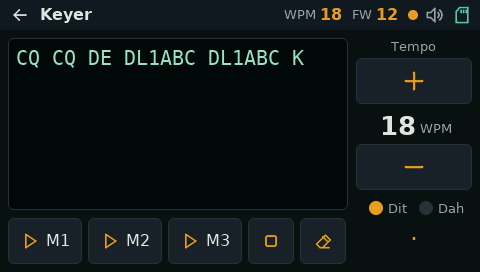
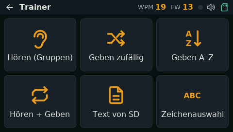
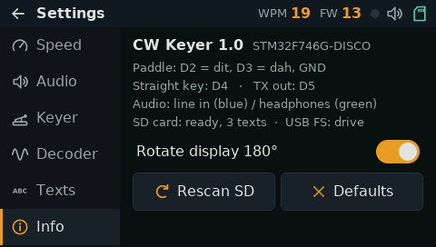
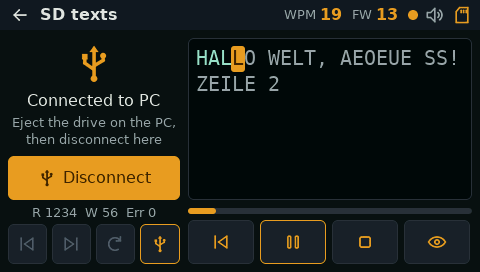

# CW Keyer – STM32F746G-DISCO

Porting the ESP8266-CW keyer (`../../CWKeyer`) to the STM32F746G discovery board
with touch controls, audio via the WM8994 codec, and practice texts from SD card.

| Start | Keyer | Monitor |
|---|---|---|
|  |  |  |
| **Coach** | **Exercise** | **SD texts** |
|  |  |  |
| ****  Memory| **Settings** | **Info / Rotate**  display|
|  |  |  |

(Screenshots from the PC simulator, same code as on the board.)

## Features

| ESP8266 (Original) | STM32F746G-DISCO |
|---|---|
| OLED text menu + rotary encoder + mode button | Touch display 480×272, tiles with icons |
| Iambic-Keyer an D6/D7 | Paddles on Arduino board D2 (Dit) / D3 (Dah), additionally hand button D4, TX output D5 |
| Buzzer / `tone()` 1000 Hz | Listening audio over headphone output (green), 400–1000 Hz, volume, soft edges (no clicking) |
| Decoder over A0 (Goertzel, 8.9 kHz) | Decoder via line-in (blue) of the codec, 16 kHz, Goertzel + adaptive threshold, WPM display, level display |
| 2 Storage (website) | 3 memory M1–M3, editing with on-screen keyboard |
| Coach letters (website) | Character selection A–Z, 0–9, `. , / ? =` + cooking lessons |
| Farnsworth on Encoder | all settings in "Settings" (tempo, audio, keyer, decoder, texts, info) |
| EEPROM | Internal flash, Sector 7, with wear leveling |
| – | Practice texts `*.txt` from SD card, playback with follow-along marker or hidden (note-taking) |
| – | Power via **USB FS (CN13), **SD card at the push of a button as a USB drive on the PC – copy texts directly |
| – | User interface in **English**, display **rotated 180°** (switchable under *Settings → info*) |

Trainer modes as in the original: *Listen* (groups of five, continue with E/T), *Give randomly*, *Give A–Z*, 
*Listen + Give* – now with hit rate and no blocking `delay(1000)`.

## Architecture

```
            ┌──────────────────────────── Gui/ ─────────────────────────────┐
            │ screens/scr_*.c   ui.c (Widgets)   gfx.c (Renderer)           │
            │ fonts.c / icons.c (generiert)                                 │
            └───────────────┬───────────────────────────────────────────────┘
                            │ liest Zustand, ruft App-Funktionen
            ┌───────────────▼──────────── App/ (hardwareunabhängig) ────────┐
            │ app.c  ── verbindet alles, Event-Queues, Mithörton-Synthese   │
            │ keyer.c   player.c   cw_decoder.c   trainer.c                 │
            │ morse.c   morse_timing.c   settings.c   text_source.c         │
            └───────────────┬───────────────────────────────────────────────┘
                            │ port.h (Hardware-Abstraktion)
     ┌──────────────────────▼──────── Platform/ ──────────────┐  ┌── Lib/ ──────┐
     │ port_stm32.c  audio_codec.c (SAI2+WM8994)  display.c   │  │ fat_ro.c     │
     │ touch.c  flash_store.c  board.c (GPIO, 1-ms-Tick)      │  │ FAT16/32 RO  │
     └──────────────────────┬─────────────────────────────────┘  └──────────────┘
                            │
     Core/ (main, Takt, MPU/Cache, Interrupts)   Drivers/ (ST HAL, CMSIS, BSP)
```

**Execution contexts**

| Context | Beat | Task |
|---|---|---|
| SysTick-Interrupt | 1 kHz | `app_tick_1ms()`: Paddle unclutter, keyer, text playback, TX output |
| SAI-DMA-Interrupt | every 4 ms | `app_audio_block()`: decoder (Goertzel), listening audio, looping line-in |
| USB-OTG-FS-Interrupt | when accessing a PC | Mass storage: read/write SD card (priority under audio and keyer) |
| Main loop | ~30 fps | `app_poll()` (Save events, trainers, settings), draw GUI, touch |

Interrupts → main loop via lock-free event queues (`event_queue.h`). 
Everything in `App/`, `Gui/` and `Lib/` is translatable without STM32 – so there are unit tests and
a PC simulator (see below).

**Assignment Original → new**

| ESP file | or |
|---|---|
| `MainLoop.ino` (Paddle logic) | `App/Src/keyer.c` |
| `SetupPlayback.ino` (`startPlayback/updatePlayback`) | `App/Src/player.c` |
| `StorageNavigation.ino` (`CalculateTimes`) | `App/Src/morse_timing.c` |
| `MorseAudio.ino`, `MorseCode.h` | `App/Src/morse.c`, listening sound in `app.c` |
| `Decoder.ino` | `App/Src/cw_decoder.c` |
| `Screens.ino` (Trainer parts) | `App/Src/trainer.c` |
| `Screens.ino`, `InputMenus.ino`, Encoder | `Gui/Src/screens/*.c` |
| `WebServer.ino`, `WebPage.h` | `scr_memory.c`, `scr_letters.c`, `scr_settings.c` |
| EEPROM | `App/Src/settings.c` + `Platform/Src/flash_store.c` |

**Improvements compared to the original decoder:** The threshold also followed the noise in the original
during breaks (trigger failure on noisy receiver). Now separate peak and noisy floor tracking
with SNR condition, separate averages for Dit and Dah (faster adjustment to tempo changes), and
Gap detection that also works with Farnsworth spacing.

## Connection

| signal | Arduino-Leiste | MCU pin |
|---|---|---|
| Paddle It | D2 | PG6 (pull-up, switch to GND) |
| Paddle Dah | D3 | PB4 (pull-up, switch to GND) |
| Handtaste (optional) | D4 | PG7 |
| TX-Tastung (optional) | D5 | PI0 (High = key pressed; Use transistor/optocoupler) |
| Mass | GND | – |
| Audio input decoder | Line-In (blue socket) | WM8994 IN1 |
| Listening sound / headphones | green socket | WM8994 HPOUT1 |

Paddles/pins can be `Platform/Inc/board.h` changed. Note: D3 is PB4 on the board (not PG7).

## Set up project (STM32CubeIDE 2.2)

The ST drivers (HAL, CMSIS, BSP, USB Device Library, Startup File) are not included for license/size reasons
and are copied once by script from the STM32CubeF7 package:

1. Get the STM32CubeF7 package – one of the variants:
   * STM32CubeMX/CubeIDE: *Manage embedded software packages → STM32F7 → installieren*
     (landet in `C:\Users\<Name>\STM32Cube\Repository\STM32Cube_FW_F7_V1.17.x`)
   * or `git clone --recursive https://github.com/STMicroelectronics/STM32CubeF7`
2. In the project folder (PowerShell):
   ```powershell
   .\setup_drivers.ps1                       # sucht das Paket automatisch
   .\setup_drivers.ps1 -CubeF7 D:\STM32CubeF7  # oder Pfad angeben
   ```
   (Linux/macOS: `sh setup_drivers.sh <pfad>`)
3. STM32CubeIDE: *File → Import → General → Existing Projects into Workspace* → diesen Ordner wählen.
4. *Project → Build Project*, dann *Run → Debug As → STM32 C/C++ Application* (ST-LINK onboard).

There is no `.ioc`-file: clock, MPU, and peripherals are in `Core/Src/main.c` or respectively. `Platform/` 
Display/SDRAM/Touch/SD via ST-BSP. This prevents CubeMX from handwriting
Code overrides. Optional: `Makefile` for the command line (`make`, needs `arm-none-eabi-gcc`).

## Power supply and USB drive (USB FS)

**Power via USB FS (CN13): Plug ** jumper **JP1 into "usb_fs"** (max. 500 mA). The USB descriptor reports the
Board accordingly as *bus-powered, 500 mA* (`Platform/Inc/usbd_conf.h`). 
To debug according to the ST manual, first connect USB FS (red LED LD2 on), then connect the ST-LINK (CN14) to the PC.

**USB drive: **Off** by default ** – on the PC, USB FS is then only used as the power supply, the SD card belongs to the keyer. 
In the SD *text* screen  , the USB button (bottom left) turns on the drive: the board logs in to the PC as
"CW Keyer SD card", the keyer no longer accesses the card (an already loaded text remains playable). 
To exit on the PC**, then disconnect on the display **** – the keyer reads the card again.



Technology: ST USB Device Library (MSC class), `Platform/Src/usb_device.c`, `usbd_conf.c`, `usbd_desc.c`, `usbd_storage.c`. 
Power on/off via `USBD_Start()`/`USBD_Stop()` (D+ pull-up on/off = cable virtually plugged in/pulled). 
USB FS requires exactly 48 MHz: CK48 comes from PLLSAI-P (192/4), because PLLQ delivers 50 MHz at 200 MHz system clock. 
Copying operations run via USB interrupt, the interface responds somewhat sluggishly, while the keyer and audio do not.

## Display rotation

The default is 180°. The GUI then draws into a third image memory, which is used with each image change
is copied to the display buffer when rotated (~1 ms); Touch coordinates are mirrored. Can be turned off under
*Settings → Info → Rotate display 180°*.

## SD card

* FAT16 or FAT32 (exFAT is not supported), files `*.txt` in the main directory or in the folder `CW/`.
* Up to 16 KiB per file. Umlauts (UTF-8 or Latin-1) become AE/OE/UE/SS, lowercase letters
  Uppercase letters, non-sendable characters are omitted.
* Examples: `SD_Card_Examples/CW/`. Card can be swapped during operation.

## Storage layout

| Area | Address | Contents |
|---|---|---|
| Flash 768 KiB | 0x08000000 | Program (approx. 300 KiB including fonts/icons) |
| Flash Sector 7 | 0x080C0000 | Settings (1-KiB records, delete only all 256 memory operations) |
| SDRAM | 0xC0000000 | 2 Bildspeicher RGB565 (Double-Buffering), MPU: Write-Through |
| SRAM2 | 0x2004C000 | Audio DMA buffer, MPU: not cacheable |

Settings are saved 3 seconds after the last change or when leaving the settings pages.

## Tests and simulator (PC, gcc)

```sh
sh Tools/test/run_tests.sh [fat16.img fat32.img]   # Morse, Timing, Keyer, Decoder (5–40 WPM, Rauschen, Farnsworth), FAT
sh Tools/sim/run_sim.sh <ausgabeordner> [sd.img]   # rendert alle Screens als PPM + Touch-Tests
```

Generators (Python + Pillow): `Tools/gen/gen_fonts.py` (DejaVu fonts, 4 bpp), 
`Tools/gen/gen_icons.py` (36 outline icons in 3 sizes), `Tools/gen/gen_cproject.py` (CubeIDE project files).

## Check the hardware for the first time

The hardware-independent part was tested on the PC; the STM32 part could not be used here for ARM
(no ST drivers/toolchain in the authoring environment). Critically accomplished:

* **USB Device Library:** expected v2.11.x (in STM32CubeF7 ≥ 1.17). In older versions,
  `USBD_LL_Transmit/PrepareReceive` a `uint16_t`-length parameter – then `Platform/Src/usbd_conf.c` adjust in .
* **BSP version:** BSP expected from STM32CubeF7 ≥ 1.16 (`BSP_SD_ReadBlocks(pData, BlockAdd, NumOfBlocks, Timeout)`, 
  `BSP_LCD_LayerRgb565Init`). Older BSPs have different signatures.
* **Line-In level:** *Settings → decoder → input gain* (WM8994 IN1-PGA, −16...+30 dB); 
  the level display on the monitor shows the signal and threshold.
* **Headphone volume:** codec fixed at −6 dB, volume is digitally controlled (`audio_codec.c`).
