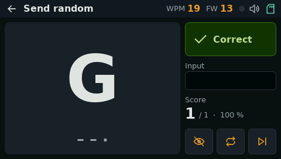
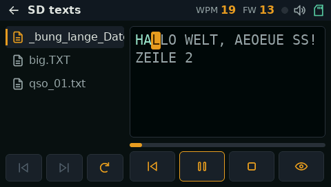
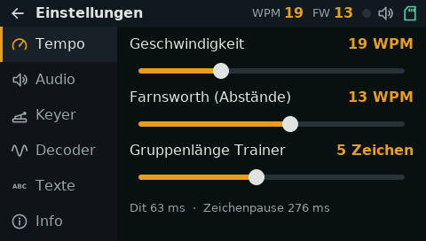

# CW Keyer – STM32F746G-DISCO

Port of the ESP8266 CW keyer (`../../CWKeyer_org`) to the STM32F746G Discovery board,
with touch controls, audio through the WM8994 codec, and practice texts from an SD card.

| Start | Keyer | Monitor |
|---|---|---|
|  |  |  |
| **Trainer** | **Practice** | **SD Texts** |
|  |  |  |
| **Memory** | **Settings** | **Character Selection** |
|  |  |  |

(Screenshots from the PC simulator; it uses the same code as the board.)

## Features

| ESP8266 (original) | STM32F746G-DISCO |
|---|---|
| OLED text menu + rotary encoder + mode button | 480×272 touch display with icon tiles |
| Iambic keyer on D6/D7 | Paddles on Arduino header D2 (Dit) / D3 (Dah), plus straight key D4 and TX output D5 |
| Buzzer / `tone()` at 1000 Hz | Sidetone through the headphone output (green), 400–1000 Hz, volume control, and soft edges (no clicking) |
| Decoder through A0 (Goertzel, 8.9 kHz) | Decoder through the codec Line-In (blue), 16 kHz, Goertzel plus adaptive threshold, WPM display, and signal-level indicator |
| 2 memories (web page) | 3 memories M1–M3, editable with the on-screen keyboard |
| Trainer letters (web page) | Character selection A–Z, 0–9, `. , / ? =`, plus Koch lessons |
| Farnsworth via encoder | All settings in **Settings** (Speed, Audio, Keyer, Decoder, Texts, Info) |
| EEPROM | Internal flash, sector 7, with wear leveling |
| – | Practice texts (`*.txt`) from an SD card, with synchronized highlighting or hidden text for copy practice |

Trainer modes are the same as in the original: *Listen* (groups of five, continue with E/T),
*Send Random*, *Send A–Z*, and *Listen + Send* — now with hit accuracy and without blocking
`delay(1000)` calls.

## Architecture

```
            ┌──────────────────────────── Gui/ ─────────────────────────────┐
            │ screens/scr_*.c   ui.c (widgets)   gfx.c (renderer)          │
            │ fonts.c / icons.c (generated)                                 │
            └───────────────┬───────────────────────────────────────────────┘
                            │ reads state, calls application functions
            ┌───────────────▼──────────── App/ (hardware-independent) ─────┐
            │ app.c  ── connects all components, event queues, sidetone synth│
            │ keyer.c   player.c   cw_decoder.c   trainer.c                 │
            │ morse.c   morse_timing.c   settings.c   text_source.c         │
            └───────────────┬───────────────────────────────────────────────┘
                            │ port.h (hardware abstraction)
     ┌──────────────────────▼──────── Platform/ ──────────────┐  ┌── Lib/ ──────┐
     │ port_stm32.c  audio_codec.c (SAI2+WM8994)  display.c   │  │ fat_ro.c     │
     │ touch.c  flash_store.c  board.c (GPIO, 1-ms tick)      │  │ FAT16/32 RO  │
     └──────────────────────┬─────────────────────────────────┘  └──────────────┘
                            │
     Core/ (main, clocks, MPU/cache, interrupts)   Drivers/ (ST HAL, CMSIS, BSP)
```

**Execution contexts**

| Context | Rate | Task |
|---|---|---|
| SysTick interrupt | 1 kHz | `app_tick_1ms()`: paddle debouncing, keyer, text playback, TX output |
| SAI DMA interrupt | Every 4 ms | `app_audio_block()`: decoder (Goertzel), sidetone, Line-In passthrough |
| Main loop | ~30 fps | `app_poll()` (events, trainer, settings storage), GUI rendering, touch |

Interrupts communicate with the main loop through lock-free event queues (`event_queue.h`).
Everything in `App/`, `Gui/`, and `Lib/` can be compiled without STM32 support, which enables
unit tests and a PC simulator (see below).

**Original-to-new mapping**

| Original ESP file | New location |
|---|---|
| `MainLoop.ino` (paddle logic) | `App/Src/keyer.c` |
| `SetupPlayback.ino` (`startPlayback/updatePlayback`) | `App/Src/player.c` |
| `StorageNavigation.ino` (`CalculateTimes`) | `App/Src/morse_timing.c` |
| `MorseAudio.ino`, `MorseCode.h` | `App/Src/morse.c`, sidetone in `app.c` |
| `Decoder.ino` | `App/Src/cw_decoder.c` |
| `Screens.ino` (trainer sections) | `App/Src/trainer.c` |
| `Screens.ino`, `InputMenus.ino`, encoder | `Gui/Src/screens/*.c` |
| `WebServer.ino`, `WebPage.h` | `scr_memory.c`, `scr_letters.c`, `scr_settings.c` |
| EEPROM | `App/Src/settings.c` + `Platform/Src/flash_store.c` |

**Improvements over the original decoder:** The original threshold also tracked noise during
pauses, which could cause false triggers with a noisy receiver. The new implementation uses
separate peak and noise-floor tracking with an SNR condition, separate averages for dit and dah
(faster adaptation to speed changes), and word-gap detection that also works with Farnsworth spacing.

## Connections

| Signal | Arduino Header | MCU Pin |
|---|---|---|
| Dit paddle | D2 | PG6 (pull-up, switch to GND) |
| Dah paddle | D3 | PB4 (pull-up, switch to GND) |
| Straight key (optional) | D4 | PG7 |
| TX keying (optional) | D5 | PI0 (high = key down; use a transistor or optocoupler) |
| Ground | GND | – |
| Decoder audio input | Line-In (blue socket) | WM8994 IN1 |
| Sidetone / headphones | Green socket | WM8994 HPOUT1 |

Paddle and pin assignments can be changed in `Platform/Inc/board.h`. Note: D3 is PB4 on the board (not PG7).

## Project Setup (STM32CubeIDE 2.2)

For licensing and repository-size reasons, the ST drivers (HAL, CMSIS, BSP, startup file) are not included.
Copy them once from the STM32CubeF7 package using the setup script:

1. Obtain the STM32CubeF7 package by one of these methods:
   * STM32CubeMX/CubeIDE: **Manage Embedded Software Packages → STM32F7 → Install**.
     It will be placed under `C:\Users\<name>\STM32Cube\Repository\STM32Cube_FW_F7_V1.17.x`.
   * Or: `git clone --recursive https://github.com/STMicroelectronics/STM32CubeF7`
2. In the project folder (PowerShell):
   ```powershell
   .\setup_drivers.ps1                       # automatically searches for the package
   .\setup_drivers.ps1 -CubeF7 D:\STM32CubeF7  # or specify the path
   ```
   (Linux/macOS: `sh setup_drivers.sh <path>`)
3. In STM32CubeIDE, select **File → Import → General → Existing Projects into Workspace** and choose this folder.
4. Select **Project → Build Project**, then **Run → Debug As → STM32 C/C++ Application** (onboard ST-LINK).

There is no `.ioc` file: clocks, MPU, and peripherals are configured in `Core/Src/main.c` and `Platform/`.
Display, SDRAM, touch, and SD use the ST BSP. This avoids CubeMX overwriting handwritten code.
Optionally, use the command-line `Makefile` (`make`, requiring `arm-none-eabi-gcc`).

## SD Card

* FAT16 or FAT32 (exFAT is not supported). Files ending in `*.txt` must be in the root directory or in the `CW/` folder.
* Maximum 16 KiB per file. Umlaute (UTF-8 or Latin-1) are converted to AE/OE/UE/SS, lowercase
  letters are converted to uppercase, and characters that cannot be transmitted are removed.
* Examples are provided in `SD_Card_Examples/CW/`. Cards can be swapped while the system is running.

## Memory Map

| Area | Address | Contents |
|---|---|---|
| 768 KiB flash | 0x08000000 | Program (about 300 KiB including fonts/icons) |
| Flash sector 7 | 0x080C0000 | Settings (1-KiB records; erased only after every 256 writes) |
| SDRAM | 0xC0000000 | 2 RGB565 frame buffers (double buffering), MPU: write-through |
| SRAM2 | 0x2004C000 | Audio DMA buffers, MPU: non-cacheable |

Settings are saved three seconds after the latest change or when leaving the Settings pages.

## Tests and Simulator (PC, GCC)

```sh
sh Tools/test/run_tests.sh [fat16.img fat32.img]   # Morse, timing, keyer, decoder (5–40 WPM, noise, Farnsworth), FAT
sh Tools/sim/run_sim.sh <output-folder> [sd.img]   # renders all screens as PPM + touch tests
```

Generators (Python + Pillow): `Tools/gen/gen_fonts.py` (DejaVu fonts, 4 bpp),
`Tools/gen/gen_icons.py` (36 outline icons in 3 sizes), `Tools/gen/gen_cproject.py` (CubeIDE project files).

## Hardware First-Test Checklist

The hardware-independent code has been tested on the PC, but the STM32 section could not be compiled
for ARM here (ST drivers/toolchain unavailable in the build environment). Common points to check:

* **BSP version:** STM32CubeF7 BSP 1.16 or later is required. The code expects
  `BSP_SD_ReadBlocks(pData, BlockAdd, NumOfBlocks, Timeout)` and `BSP_LCD_LayerRgb565Init`.
  Older BSPs use different signatures.
* **Line-In level:** **Settings → Decoder → Input Gain** (WM8994 IN1 PGA, −16…+30 dB).
  The level meter in Monitor shows the signal and threshold.
* **Headphone volume:** The codec is fixed at −6 dB; volume is controlled digitally in `audio_codec.c`.
